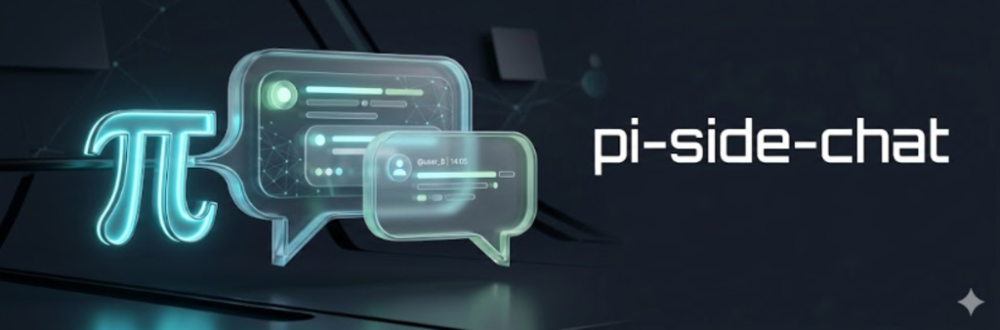

<p>
  
</p>

# PiBtw

De0ta 基于 [yceachan/pi-better-btw](https://github.com/yceachan/ea-pi-extensions/tree/main/packages/pi-better-btw) 独立维护的定制版，主要优化旁路聊天布局、主题配色和输入交互。本仓库不是上游 npm 发布版；原包名和下方 npm 徽章仍指向上游版本。来源与本地开发说明见 [UPSTREAM.md](UPSTREAM.md)。

**[English](README.md) | 简体中文**

> [!note]
>
> 基于 **yceachan** 在 [ea-pi-extensions](https://github.com/yceachan/ea-pi-extensions) 中维护的 pi-better-btw，后者源自 **Nico Bailon** 的 [pi-side-chat](https://github.com/nicobailon/pi-side-chat)。保留原 MIT 许可证与版权声明。

## TL;DR

**把当前会话 fork 到一个旁路会话（btw）中，主线 agent 继续干活。**

[](https://www.npmjs.com/package/@yceachan/pi-better-btw)
[](LICENSE)

```bash
# 在本地 PiBtw 目录运行（npm 包仍是上游版本）
pi -e ./srcs/index.ts
# in pi tui
> /btw  || or Alt+W
```

你在处理一个较长任务时，想顺便问点小事又不想打断主线——查一个 API 细节、验证一个思路、搜点东西，或者看看主线 agent 在干什么。打开BTW Tui OverLay，提问，关闭。主线线程完全不受打扰。


## Feat

> [!note]
>
> **Thats Why Called Better-Btw**
>
> Author 尝试过[nicobailon/pi-side-chat](https://github.com/nicobailon/pi-side-chat)  与[dbachelder/pi-btw](https://github.com/dbachelder/pi-btw)，均是简单从main 主线fork，如果 agent on turn ,均会出现尝试推进主线的情况，see[[feat request\] btw aside-session self-cognition — the side chat must not continue the main session's work · Issue #5 · nicobailon/pi-side-chat](https://github.com/nicobailon/pi-side-chat/issues/5)。
>
> 于是精心开发了如下feat

- `Aside-Agent self-Cognition` ：注入主线上下文，便于对工程主线 ask a btw question；同时做出精心的上下文工程优化，强化辅助Agent认知，**避免全量主线上下文的tool call trace干扰认知，与主线竞争推进工程**。同时保留主线共享前缀，实现较好的缓存命中。

- `Prompt pack`: 所有提示此注入均文档化+ `bundle`/`$PI_HOME` / `$CWD`三级覆盖。

- `TUI scroll,select,copy` ：在TUI-overlay 自订阅鼠标/hotkey事件，实现滚屏 ，text选中 ， Ctrl +C 复制功能

- `Readonly/Edit Mode` : 默认只读来回应btw question，如果你希望Agent顺手做些小修改，Ctrl + t To Edit Mode.

  - ToolAllowList : bundle + config.json custom

  | 模式 | 工具                                                         |
  | ---- | ------------------------------------------------------------ |
  | 只读 | `read`、`grep`、`find`、`ls` ;`peek_main`  ;`config.json.readOnlyExtensionAllowlist` |
  | 编辑 | `read`、`bash`、`edit`、`write`                              |

## Usage

用 `/btw`（别名 `/side`）或 `Alt+W`（同时负责后台/显示切换）打开旁路会话。提问后按 `Enter`。

按 `Esc` 打开关闭确认浮窗（默认选择保留）；确认后中止生成并丢弃旁路历史。在选择器、确认框或快捷键页面内，`Esc` 仅返回聊天。`Alt+W` 隐藏／恢复，生成不中断；也可用 `/btw` 恢复，草稿、历史和滚动位置保留。主编辑器内可用 `/btw-close` 请求确认关闭。旧的 `Ctrl+Alt+W` 已移除。

主界面默认底栏模型右侧显示 `[● side chat]`：黄色表示思考/生成中，绿色表示空闲，隐藏时仍显示，真正关闭后消失。不会替换其他扩展的自定义底栏；自定义底栏使用标准扩展状态作为兼容回退，具体位置由该底栏决定。

旁路内 `Ctrl+P` 循环切换模型（优先使用 Pi 配置的模型范围，否则使用全部已认证模型），`Ctrl+Shift+P` 反向切换（Windows 可用 `Alt+P`），`Shift+Tab` 循环切换模型支持的思考强度。这些动作跟随 Pi 的按键配置，提示显示实际按键。`Alt+M` 搜索模型，`Alt+T` 打开思考强度选择器；全部只影响旁路。首次创建继承主线设置，之后独立（本次 Pi 运行期间记忆，不写入主线设置）；不支持思考的模型自动设为 `off`。生成中请先 `Alt+S` 停止再切换。

旁路采用无边框面板，标题与模型信息同排显示，压缩输入区上方空白。面板背景跟随主主题和终端颜色，深色模式略提亮、浅色模式略压暗；仅用户消息保留带内边距的原生背景卡片，不再显示 `[You]`，AI 回复与面板同底色。输入区为左右内收的轻量卡片，使用低反差的主题衍生底色；空白时约三行（含上下留白），多行输入按需增长，最多显示五行正文，并始终保留光标所在行。淡色 `›` 和“问点什么…”仅作显示，不进入草稿。卡片外的常用提示自适应为一行，窄窗逐步隐藏次要操作，完整快捷键仍可通过 `?` 查看。提示使用主题的正文色与弱化色，不再固定白色／灰色；完整快捷键页保留顶部、底部与左右内边距。输入框为空时按 `?` 查看自适应分栏的完整快捷键页，`Esc` 返回；已有草稿时 `?` 正常输入。助手回答直接复用 Pi 主对话的消息渲染器，支持 Markdown、代码高亮、表格和思考内容，流式输出同样生效。上方截图为上游旧版界面。

| 快捷键 | 作用 |
| ------ | ---- |
| `Alt+W` | 打开（关闭时）/ 后台化（显示时）/ 恢复（隐藏时） |
| `Ctrl+T` | 切换只读 / 编辑模式 |
| `Alt+R` | 从最新主线上下文重新 fork |
| `Alt+N` | 开始空白对话 |
| `Alt+E` | 导出对话记录到 `$CWD/.agents/eval/pi-better-btw-<timestamp>.md` |

在Readonly Mode(default),只读车道是**强制的**：越权调用工具会被硬阻断并注入prompt；第二次违规会升级措辞并中止该轮，提示（`🚧 lane blocked` 状态行）。已执行但失败的只读调用会被 `afterToolCall` 备注再次归位。编辑模式（`Ctrl+T`）不受影响。

**窥视主线 agent** —— `peek_main` 工具读取主线会话的近期活动。

```text
What is the main agent doing right now?
What changed since I opened this side chat?
```

**非抢占浮层 + 后台化** —— 浮层默认居中，占终端宽度 90%、高度最多 92%（保留外边距）。浮层打开期间始终聚焦；`Alt+W` 将其后台化（隐藏，agent 继续流式输出）交还键盘，再按 `Alt+W` 恢复显示。

**实时布局切换** —— `Ctrl+Alt+←` 铺满终端，`Ctrl+Alt+↑` 恢复初始小窗（85% 宽、顶部居中、原始自适应高度），`Ctrl+Alt+↓` 使用后来的大悬浮窗（90% 宽、高度最多 92%、中央居中），`Ctrl+Alt+→` 使用全高右半屏。默认仍为大悬浮窗；在快捷键页、选择器中也可切换。切换保留 agent、历史、后台生成与草稿；因换行宽度变化，仅清除当前文本选区。布局随终端尺寸变化，并按多行草稿的实际高度预留输入空间，避免控件被裁掉。这里的全屏仅改变浮层尺寸，不切换 Pi 的终端模式。

**消息跳转** —— `Ctrl+↑`／`Ctrl+↓` 跳到上一条／下一条用户提问或 AI 正文开头，跟随 Pi 的 `tui.altScreen.previousPrompt`／`nextPrompt` 按键配置（支持自定义重映射）。跳过工具调用与结果，包含正在生成的 AI 正文；不改变草稿或中断生成。

**滚动历史** —— `PgUp`/`PgDn` 整页滚动，`Shift+↑`/`Shift+↓` 按行滚动，鼠标指针悬停于聊天区域时滚轮滚动。离开最新消息时，标题栏出现 `[↑N]` 指示器。流式期间视口跟随底部；一旦你向上滚动就冻结内容锚定（新行增长滚动偏移而不是滑动可见内容），回到底部或新消息后恢复跟随。

**鼠标选择 + 快捷键复制** —— 拖拽选择聊天文本（反色高亮）；双击选择整行。复制仅限快捷键：`Ctrl+C` / `Ctrl+Shift+C` 通过原生剪贴板级联（`wl-copy`/`xclip`，OSC 52 兜底）复制保留的选择；选择保持高亮，可重复按复制。拖拽不碰剪贴板，鼠标交互不阻塞事件循环。Pi 1.0 全屏模式下，浮层使用 Pi 的标准鼠标分发与拖拽捕获接口；点击输入区可定位光标。后台化或关闭浮层后，Pi 主界面的鼠标操作保持可用。常规模式下，扩展自管的鼠标上报跟随浮层*可见性*，后台化时恢复终端原生选择。

**对话导出** —— `Alt+E` 把 btw 历史（fork 上下文、framing 块、对话、流式中内容）导出为 `$CWD/.agents/eval/pi-better-btw-<timestamp>.md` 的 markdown 诊断产物，便于调试功能开发。

## 快捷键

| 按键 | 作用 |
| ---- | ---- |
| `Alt+W` | 打开（关闭时）/ 后台化（显示时）/ 恢复（隐藏时） |
| `Enter` | 发送消息 |
| `Esc` | 请求确认关闭；在选择器／确认框／快捷键页内仅返回聊天 |
| `?` | 打开完整快捷键页（输入框为空时） |
| `Ctrl+Alt+←` | 铺满终端 |
| `Ctrl+Alt+↑` | 初始小窗，顶部居中 |
| `Ctrl+Alt+↓` | 后来的大悬浮窗，中央居中 |
| `Ctrl+Alt+→` | 全高右半屏 |
| `Ctrl+↑`／`Ctrl+↓` | 上一条／下一条消息（跟随 Pi 配置） |
| `Ctrl+P` / `Ctrl+Shift+P` | 循环切换旁路模型／反向切换（跟随 Pi 配置） |
| `Alt+P` | 反向切换模型（Windows 备选） |
| `Shift+Tab` | 循环切换支持的旁路思考强度（跟随 Pi 配置） |
| `Alt+S` | 停止当前生成但保留旁路 |
| `Alt+M` | 选择旁路模型（可搜索） |
| `Alt+T` | 选择旁路思考强度 |
| `Alt+R` | 从最新主线上下文重新 fork |
| `Alt+N` | 开始空白对话 |
| `Alt+E` | 导出 btw 对话历史到 `$CWD/.agents/eval/pi-better-btw-<timestamp>.md` |
| `Ctrl+T` | 切换只读 / 编辑模式 |
| `PgUp` / `PgDn` | 整页滚动历史 |
| `Shift+↑` / `Shift+↓` | 按行滚动 |
| 鼠标滚轮 | 指针位于聊天区域时滚动 |
| 鼠标拖拽 | 选择聊天文本（反色高亮）；松开不自动复制 |
| 双击 | 选择整行 |
| `Ctrl+C` / `Ctrl+Shift+C` | 复制当前鼠标选择（仅快捷键；选择保留到下次点击，可重复复制） |

## 命令参考

### `/btw`

打开旁路会话浮层。`/side` 的别名。

### `/side`

打开旁路会话浮层（保留上游命令名作为兼容别名）。

### `/btw-close`

显示关闭确认浮窗；旁路隐藏时先恢复显示，不会直接关闭。无旁路时不做操作。

### `peek_main`

仅旁路 agent 可用。

| 参数 | 类型 | 说明 |
| ---- | ---- | ---- |
| `lines` | integer | 最多检查条数（默认 20，最大 50） |
| `since_fork` | boolean | 仅显示旁路会话打开之后的活动 |

## 配置

pi-better-btw 从三个位置按优先级递增读取 `config.json` —— 每层只覆盖它实际定义的键：

| 层 | 位置 |
| -- | -- |
| Bundle（默认） | 扩展目录下的 `config.json` —— 随 git 跟踪，随发布包分发 |
| 用户 | `~/.pi/agent/pi-better-btw/config.json` |
| 项目 | `<project>/.pi/pi-better-btw/config.json` |

键：

- `readOnlyExtensionAllowlist` —— 只读车道允许的扩展工具名（车道始终包含内置只读工具 `read`/`grep`/`find`/`ls` 和 `peek_main`）。各层按 bundle → user → project 顺序**取并集**（去重，先到先得）：高层只增不减。
- `readOnlyExtensionAllowlistExclude` —— 从最终列表中移除的工具名，例如用于去掉某个内置默认。
- `promptPack` —— 提示包清单（见下）；按键合并，高层优先。相对路径按所在层目录解析，用户级 manifest 可放在用户配置旁边；绝对路径亦可。

示例（用户或项目层）：

```json
{
  "readOnlyExtensionAllowlist": ["pi-vision-helper", "lens_diagnostics"],
  "readOnlyExtensionAllowlistExclude": ["web_search"]
}
```

### 提示包清单

`promptPack` 把每条注入提示映射到一个 markdown 文件（相对于本层目录，或绝对路径）。所有键均可选——缺失或不可读的键回退到随包的 `prompts/` 默认值（并给出 UI 警告）：

| 键 | 内置默认 | 注入时机 |
| -- | -------- | ---- |
| `promptPack.framing` | `prompts/btw-framing.md` | fork 上下文之后（不作为聊天气泡渲染）——把引用框定为"仅供引用" |
| `promptPack.focusAnchor` | `prompts/btw-focus-anchor.md` | 每轮——"只回答 btw 最新消息" |
| `promptPack.laneReminders.base` | `prompts/lane-reminder-base.md` | 第一次只读违规（`{{tool}}` / `{{count}}`） |
| `promptPack.laneReminders.escalated` | `prompts/lane-reminder-escalated.md` | 第二次违规，中止本轮之前 |
| `promptPack.laneReminders.failedNote` | `prompts/lane-failed-note.md` | 已执行但失败的只读调用之后 |
| `promptPack.laneReminders.preamble` | `prompts/lane-preamble.md` | 只读车道开场白 |

随包的 `config.json` 只读白名单默认只含官方 pi 工具集合（`web_search`、`source_check`、`fetch_content`、`get_search_content`）；第三方工具（pi-lens、context7、vision 等）通过用户层追加。

## 工作原理

扩展克隆当前会话上下文，创建带全部扩展工具的独立 agent 实例，并在 TUI 浮层中渲染。隐藏（`Alt+W`）通过 overlay handle 保留整个 agent 与草稿，后台继续运行；确认关闭后销毁，下次打开从最新主线上下文创建新旁路。

Pi 暂无模型行状态插槽，默认底栏指示器通过导出的 `FooterComponent` 渲染适配实现，不修改 Pi 安装文件；关闭会清除指示器，扩展卸载时还原适配。该定位依赖 Pi 底栏实现，已在当前 Pi 1.4 API 下测试。状态始终发布到 `setStatus`；默认底栏仅将自己的状态从第三行移到模型行，自定义底栏与运行时切换底栏时仍可读取，不抢占 `setFooter`。

旁路请求走 `modelRegistry.streamSimple`，由当前 Pi 的模型运行时处理认证、请求头和虚拟模型路由。

btw 上下文保留主线的 system prompt 于 system 槽位，并逐字注入 fork 快照，使 btw 请求头成为主线请求的 token 前缀（网关前缀缓存命中）。`forkSurgery`（`srcs/fork-surgery.ts`）让快照的尾部工具交换对网关合法；提示包供给全部注入文本；车道强制在只读模式下包装 `beforeToolCall`/`afterToolCall`（`srcs/side-chat-overlay.ts`）。

主线 agent 的工具执行事件被跟踪以维护已写文件路径集合（`srcs/file-activity-tracker.ts`）；写类工具被包装以在触碰这些路径前警告（`srcs/tool-wrapper.ts`）。

全屏模式（Pi 1.0 默认）下，`SideChatOverlay.handleMouse()` 接收 Pi 分发的组件局部坐标事件，处理滚轮、捕获聊天区的选择拖拽，并把输入区点击转交给编辑器定位光标。复制仍只由快捷键触发，终端鼠标上报始终归 Pi 管理。常规模式保留原始 SGR 监听器：仅在浮层可见时启用上报，并在鼠标序列进入编辑器前消费它们。

`peek_main` 按需读取当前会话分支并返回紧凑摘要。

## 开发

结构：

```text
.
├── srcs/                  # TypeScript 实现（pi 直接加载 TS，无构建步骤）
│   ├── index.ts           # 扩展入口：命令、快捷键、浮层生命周期
│   ├── config.ts          # 分层配置解析（bundle / user / project）
│   ├── prompt-pack.ts     # 提示包清单加载 + 模板替换
│   ├── fork-surgery.ts    # 共享前缀 fork 快照手术（网关合法尾部）
│   ├── side-chat-overlay.ts  # TUI 浮层、agent 生命周期、车道强制、鼠标路由
│   ├── side-chat-messages.ts # 消息渲染、换行、选择、滚动
│   ├── side-chat-mouse.ts    # 最小 SGR 鼠标解析
│   ├── side-chat-export.ts   # Alt+E 对话导出
│   ├── side-chat-status.ts   # 主底栏指示器、兼容状态回退
│   ├── side-chat-dialog.ts   # 模型/思考/关闭确认浮窗
│   ├── side-chat-input.ts    # 轻量输入卡片、原生光标与鼠标坐标映射
│   ├── side-chat-panel.ts    # 跟随主题／终端的面板、输入框与用户卡片背景
│   ├── side-chat-layout.ts   # 全屏／初始小窗／大悬浮窗／右半屏布局
│   ├── tool-wrapper.ts       # 写路径重叠警告
│   └── file-activity-tracker.ts
├── prompts/               # 随包提示包默认值（framing、焦点锚、车道提醒）
├── test/                  # bun test 测试套件（配置解析、鼠标选择）
├── config.json            # 内置默认（promptPack 清单 + 只读白名单）
├── banner.png
└── README.md
```

命令：

```bash
bun install         # 安装依赖
bun run typecheck   # tsc --noEmit -p tsconfig.json
bun test            # bun test test/（串行运行，见 bunfig.toml）
```

发布包包含 `srcs/`、`prompts/`、`config.json` 与文档；测试不进入 tarball。开发时把 pi 的扩展加载器指向 `./srcs/index.ts`，改完代码 `/reload` 即可（无构建步骤——pi 直接加载 TypeScript）。

## 限制

- 同一时间只能有一个旁路会话
- 无法在另一个可见浮层之上打开
- 不会把消息合并回主线会话
- bash 重叠检测是启发式的——覆盖常见写模式，非全部
- `peek_main` 是按需读取，非实时
- 全屏鼠标支持使用 Pi 1.0 的组件鼠标 API；常规模式继续使用 SGR 兼容路径

## License

MIT —— 见 [LICENSE](LICENSE)。许可证同时保留两行版权：上游原作者（Nico Bailon）与 fork 修改者（yceachan）。